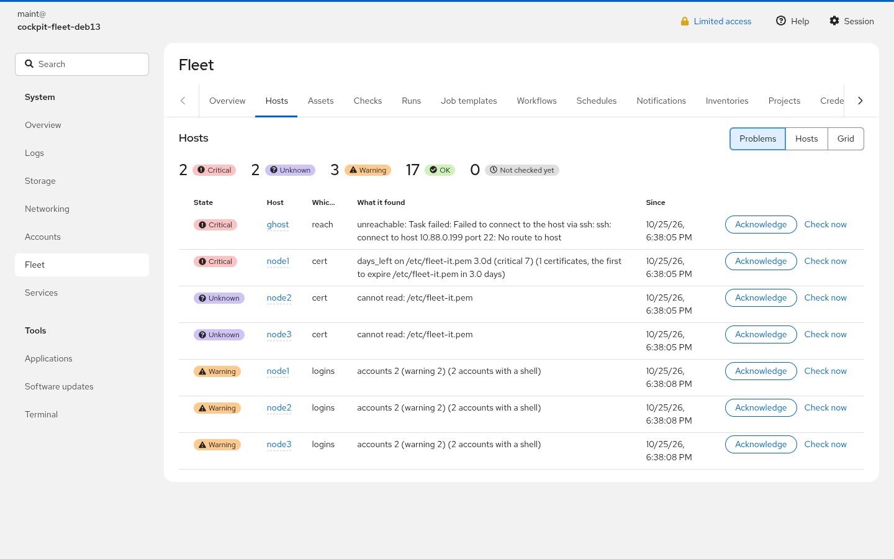
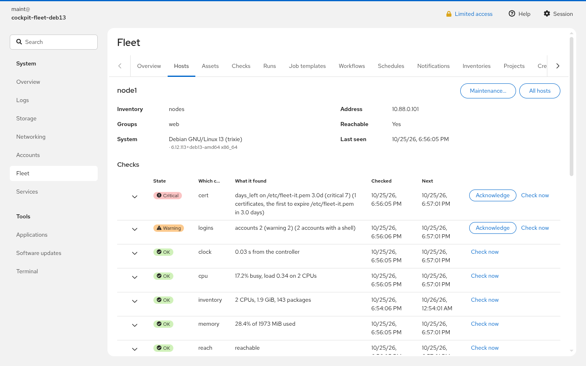
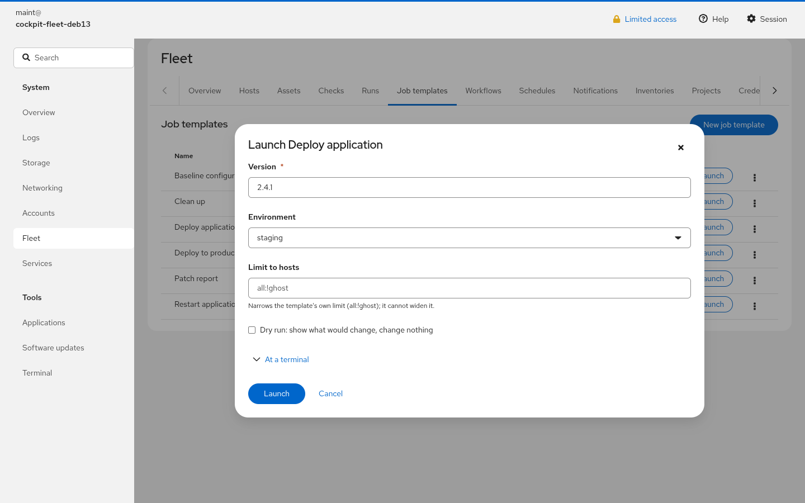
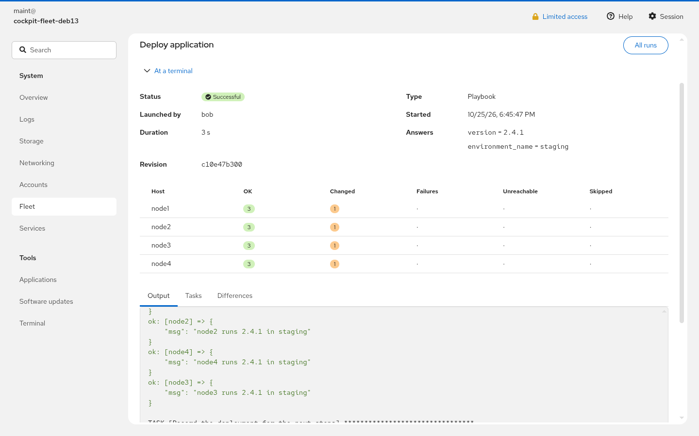
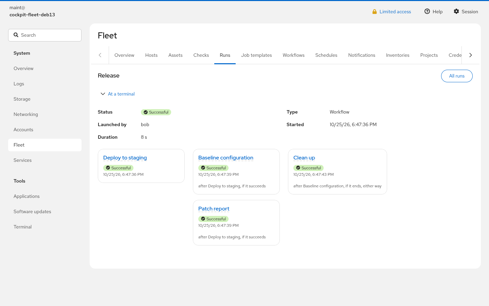
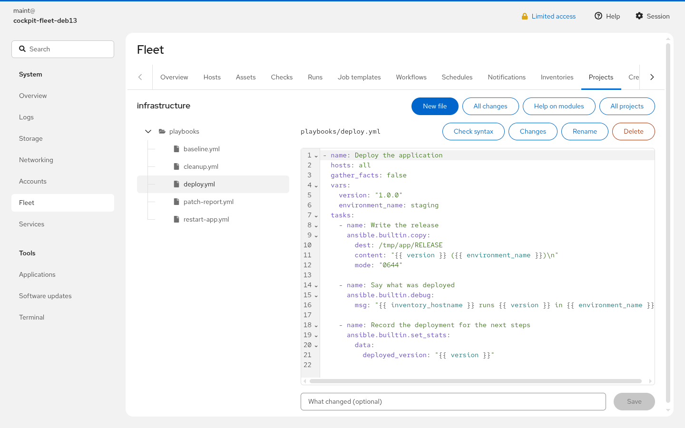
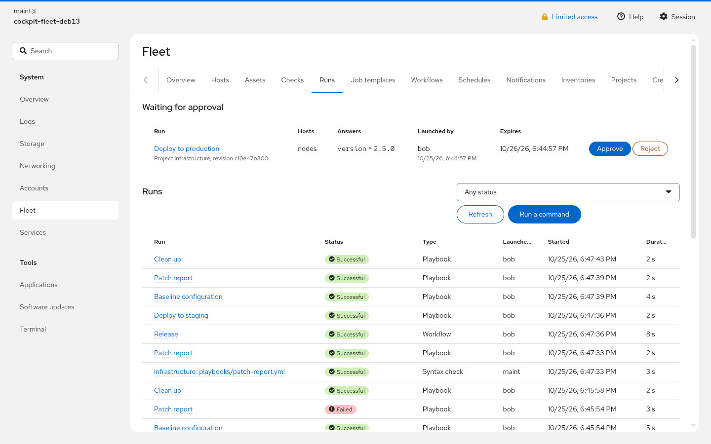
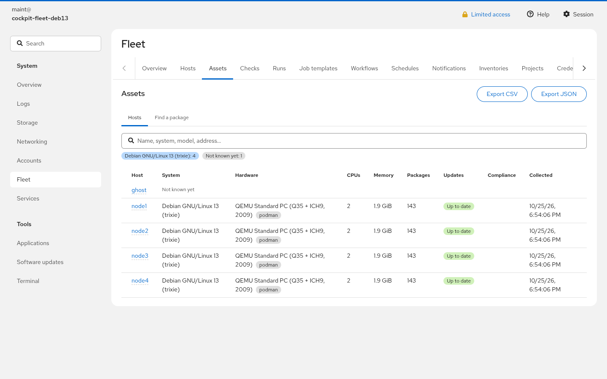

# cockpit-fleet

Cockpit plugin to run Ansible from the web console and to watch a fleet of
nodes through Ansible alone, without installing an agent on them.

> **Status: early releases (0.x).** Tested on Debian 13, Fedora 44 and
> AlmaLinux 10; what changed is in [CHANGELOG.md](CHANGELOG.md), what is
> planned in [TODO.md](TODO.md).

| | |
|---|---|
|  |  |
| Problems of the hosts | A host and its checks |
|  |  |
| Launching a template | A run |
|  |  |
| A workflow | Writing a playbook in the browser |
|  |  |
| Runs and approvals | Assets |

## Documentation

- [docs/install.md](docs/install.md): installing a controller, giving
  people access, the configuration, the first steps
- [docs/security.md](docs/security.md): what it protects, from whom, and
  what it does not
- [docs/checks.md](docs/checks.md): watching nodes, and writing a check as a
  playbook
- [docs/backup.md](docs/backup.md): what to back up and how to restore it
- [docs/chat.md](docs/chat.md): turning on the assistant
- `man fleet`: the command for a terminal
- [docs/architecture.md](docs/architecture.md): how it is built, and why

## What it does

- **Run playbooks** — projects from git, a local directory, an in-browser
  editor or an uploaded archive; inventories, credentials, job templates with
  survey forms, dry runs with diff, schedules, workflows and approvals.
- **Watch the fleet** — health checks with states, hardware and software
  inventory, pending updates, configuration drift, with history and charts.
- **Notify** — Telegram, generic webhook, email, Matrix.

Managed nodes can be anything Ansible reaches: Linux, Windows over SSH,
network devices.

## How it works

No daemon and no listening port. A run is a systemd unit started on demand,
sandboxed, under an unprivileged account; secrets are encrypted with
`systemd-creds` and only PID 1 can decrypt them, for the one run that needs
them. Details and measurements are in [docs/architecture.md](docs/architecture.md),
the security model in [docs/security.md](docs/security.md).

## Requirements

- Controller: Debian 13, Fedora 44 or AlmaLinux 10, with Cockpit ≥ 337,
  `ansible-core` ≥ 2.16, systemd ≥ 257, Python ≥ 3.12
- Development machine: Node.js ≥ 22, npm, Make, Python ≥ 3.12, podman (to build the packages)

## Build and install

```bash
npm install
make deb                                    # builds deb/cockpit-fleet_<version>_all.deb
sudo apt install ./deb/cockpit-fleet_*.deb  # on a Debian controller
make rpm                                    # builds rpm/cockpit-fleet-<version>-1.{fc44,el10}.noarch.rpm
sudo dnf install ./rpm/cockpit-fleet-*.fc44.noarch.rpm  # on Fedora; .el10 on AlmaLinux
```

The package creates the `cockpit-fleet` account and three role groups:
`cockpit-fleet-admin`, `cockpit-fleet-operator`, `cockpit-fleet-viewer`; and
`cockpit-fleet-approver`, whose members approve the runs of the templates that
need it, whatever their role. What each may do, and what to set up first, is
in [docs/install.md](docs/install.md).

## Development

```bash
make watch          # rebuild the frontend on change
make check          # frontend and backend unit tests
make devel-install  # symlink dist/ into ~/.local/share/cockpit (frontend only)
make help           # all targets
```

Anything beyond the frontend (unit, helpers, sudoers) needs the package
installed. The integration tests in `test/integration/` run as root on a
controller and check the privilege boundaries and the run sandbox. `make
ct-test DISTRO=debian|fedora|alma` runs them in containers of that
distribution, with rootless podman.

Translations: strings are English in the source; `make pot` extracts them,
`po/it.po` holds the Italian text and `make po-compile` compiles it.

## License

Same license as the Cockpit project: **GNU LGPL v2.1 or later**
(`LGPL-2.1-or-later`). See [LICENSE](LICENSE).
